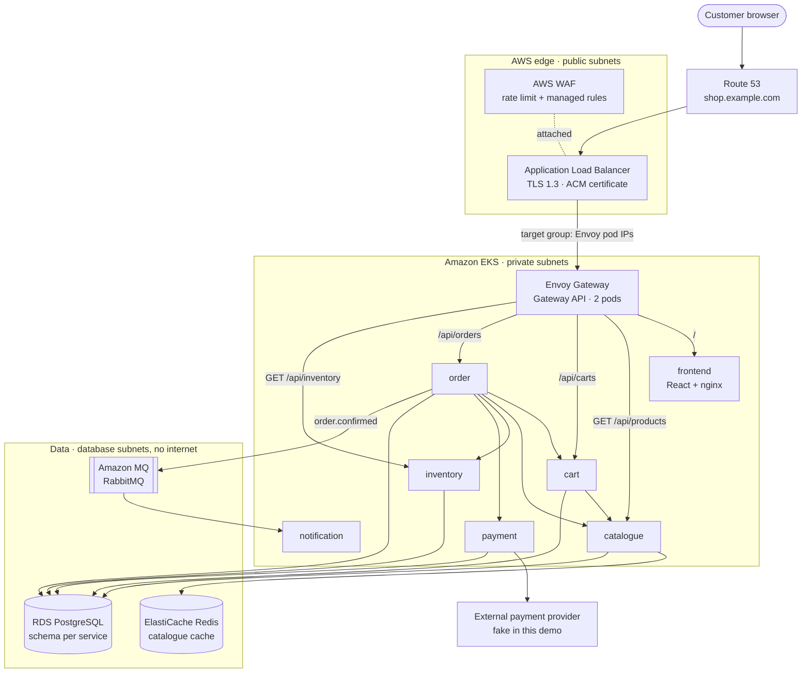
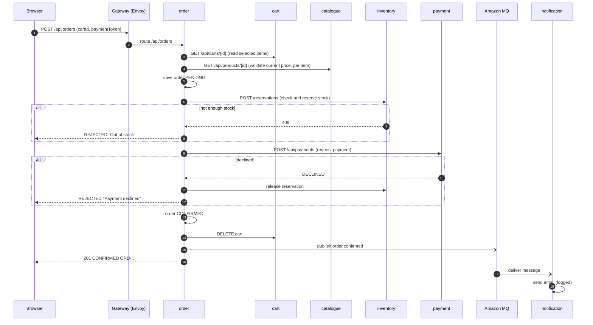

# Storefront — project overview

A small online shop built the way real ones are: a React website, six Java
microservices on Amazon EKS, PostgreSQL on RDS, Redis on ElastiCache and
RabbitMQ on Amazon MQ. Everything is created by code and can be torn down
again with two commands.

> **In plain words.** Think of a department store. **Route 53** is the street sign,
> the **ALB with WAF** is the front door with a security guard, the **Gateway** is the
> information desk that sends you to the right counter, each **Service** is a counter
> (products, cart, checkout, stock, payments), and the **databases** are the stock
> rooms behind the counters. The **message queue** is the internal mail: checkout
> drops a note "order confirmed" and the notifications team picks it up when it can.

---

## 1. The three deliverables

| Zip | What's inside | Who uses it |
|---|---|---|
| `storefront-infra.zip` | Terraform: VPC, EKS, RDS, ElastiCache, Amazon MQ, ECR, ALB, WAF, ACM, Route 53, IAM | platform / cloud engineer, once |
| `storefront-eks.zip` | Helm values, Gateway API, TargetGroupBinding, secrets, Deployments, routes, policies, scripts | platform engineer, every deploy |
| `storefront-app.zip` | Java services, React frontend, Dockerfiles, docker compose for local runs | developers, every day |

Unzip all three side by side (`infra/`, `eks/`, `app/`) — the eks scripts read
Terraform outputs from `../infra`.

---

## 2. Architecture



### Mapping to your reference diagram

| Reference diagram | This project |
|---|---|
| Route 53 · DNS resolution | `aws_route53_record.app` (alias to ALB) |
| AWS WAF · attached protection | `aws_wafv2_web_acl` + association to the ALB |
| Public ALB | `aws_lb.app`, HTTPS only, forwards to the Gateway |
| Browse products → Catalogue → Redis / Product DB | catalogue-service, cache-aside with `@Cacheable` |
| Add or view items → Cart → Cart DB | cart-service, schema `cart` |
| Checkout → Order service → save, read items, reserve stock, request payment, validate products | order-service `CheckoutService`, steps 1–7 |
| Inventory → Inventory DB | inventory-service, atomic `UPDATE … WHERE available >= qty` |
| Payment → Payment records DB + External provider | payment-service + `FakePaymentProvider` |
| RabbitMQ exchange → Notification queue → Notification service | Amazon MQ, exchange `storefront.orders`, queue `notification.order-confirmed` |
| Delivery queue / service / courier / tracking | **left out** (you asked for catalogue, cart, order, inventory, payment). Add a `delivery-service` that binds its own queue to the same exchange — no change to order-service. |

---

## 3. What happens when you check out



Three design choices worth knowing:

1. **Synchronous where the customer waits, asynchronous where they don't.** Stock and
   payment must be known before we answer, so they are HTTP calls. The email is not,
   so it goes through the queue — if notification is down, checkout still works and
   the message waits in RabbitMQ.
2. **Every step can be undone.** If payment fails, the stock reservation is released.
   Inventory and payment are both *idempotent* by order reference, so retries never
   double-reserve or double-charge.
3. **Prices come from the catalogue at checkout**, not from the cart, so a stale cart
   can't buy at an old price.

---

## 4. Services

| Service | Responsibility | Store | Exposed via Gateway |
|---|---|---|---|
| **frontend** | React 19 shop UI, served by nginx | — | `/` |
| **catalogue** | product list and details | PostgreSQL `catalogue` + **Redis** (10 min TTL) | `GET /api/products` |
| **cart** | items per cart (cart id = UUID in the browser) | PostgreSQL `cart` | `/api/carts` |
| **inventory** | stock levels, reservations | PostgreSQL `inventory` | `GET /api/inventory` |
| **order** | checkout orchestration, order history | PostgreSQL `ordering` | `/api/orders` |
| **payment** | charges, idempotent per order | PostgreSQL `payment` | **no** — internal only |
| **notification** | consumes `order.confirmed`, sends email | — | **no** — queue consumer |

**Tech:** Java 21 · Spring Boot 4.1 · Spring Data JPA · Flyway · Spring AMQP · React 19 · Vite.

### Data design

One RDS PostgreSQL database, **one schema per service**. Each service's Flyway
migrations create its own schema and tables at startup. Services never join across
schemas — they call each other's APIs. This keeps one cheap database while preserving
the microservice rule "own your data"; splitting a schema into its own RDS instance
later is a connection-string change.

### Caching (catalogue)

```
GET /api/products/3
   ├─ Redis has "catalogue::product::3"?  → yes → return it        (fast path)
   └─ no → SELECT from PostgreSQL → write to Redis (TTL 10 min) → return
```

### Messaging (Amazon MQ for RabbitMQ)

```
storefront.orders (topic exchange)
   └── routing key "order.confirmed" ──▶ notification.order-confirmed (queue)
                                            └── fails 3× ──▶ storefront.dlx ──▶ …order-confirmed.dlq
```

Publishers know only the exchange. Each consumer declares and binds its own queue,
so adding delivery or analytics consumers never touches order-service.

---

## 5. Security, layer by layer

| Layer | Control |
|---|---|
| Edge | WAF: per-IP rate limit, AWS IP reputation, OWASP common rules, known bad inputs, SQL injection |
| Transport | TLS 1.3 at the ALB; TLS to RDS (`sslmode=require`), Redis (in-transit encryption + AUTH), MQ (AMQPS) |
| Network (AWS) | data stores in database subnets with no internet route; security groups allow only EKS nodes, only the right port |
| Network (cluster) | NetworkPolicies: default-deny, then only the arrows in the diagram; payment reachable only from order |
| Exposure | payment and notification have no HTTPRoute; inventory reservations blocked at the Gateway (GET only) |
| Identity | EKS Pod Identity for controllers; no AWS keys anywhere; apps get no Kubernetes API token |
| Secrets | AWS Secrets Manager → External Secrets → Kubernetes Secrets; never in Git |
| Workloads | Pod Security `restricted`: non-root, read-only filesystem, no capabilities, seccomp |
| Images | ECR immutable tags, scan on push |

---

## 6. Build it end to end

```bash
# 0) unzip side by side
unzip storefront-infra.zip; unzip storefront-eks.zip; unzip storefront-app.zip

# 1) try it on your laptop first (no AWS needed)
cd app && docker compose up --build        # http://localhost:8080

# 2) AWS infrastructure (~25 min)
cd ../infra
cp terraform.tfvars.example terraform.tfvars   # set domain_name
terraform init -backend-config="bucket=<state-bucket>"
terraform apply

# 3) images → ECR
cd ../app && ./scripts/build-and-push.sh       # prints the tag

# 4) cluster
cd ../eks
./scripts/01-kubeconfig.sh
./scripts/02-install-addons.sh
./scripts/03-deploy-platform.sh
./scripts/04-deploy-apps.sh <tag>
./scripts/05-verify.sh                          # https://shop.<domain> end to end
```

Tear down: `eks/scripts/99-teardown.sh`, then `terraform destroy` in `infra/`.

---

## 7. Kept simple on purpose (and how to grow it)

| Today | Production next step |
|---|---|
| no login; cart id lives in the browser | Amazon Cognito + JWT validation at the Gateway (`SecurityPolicy`) |
| one DB user for all schemas | one user per service with rights on its own schema |
| event published right after commit | transactional outbox, so no event is ever lost |
| fake payment provider | real provider SDK + webhooks |
| emails written to the log | Amazon SES / SNS |
| single NAT, single-AZ data stores | `high_availability = true` in Terraform |
| deploy with scripts | Argo CD + the DevSecOps pipelines (security gate, signed images) |
| logs to stdout (JSON) | CloudWatch Container Insights or OpenTelemetry → your APM |
